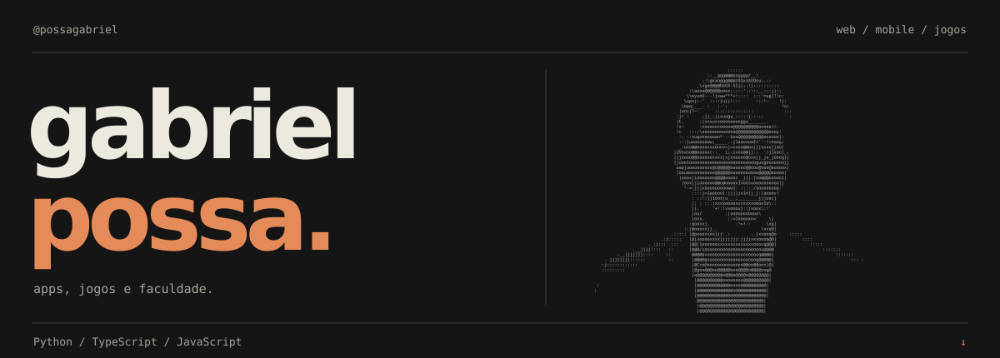

  

### Olá, eu sou o Gabriel.

Desenvolvo aplicações e jogos, explorando diferentes formas de transformar ideias em experiências que funcionam na prática. Por aqui, você encontra projetos de **web e mobile**, além de experimentos com **jogos e computação gráfica**.

**TypeScript · JavaScript · React Native · Expo · Python · Pygame**

---

### Projetos em destaque

#### [01 / Gerenciador de Validades](https://github.com/possagabriel/gerenciador-validades-distribuidora-lima)

Aplicativo mobile para a Distribuidora Lima: gestão de produtos e lotes, acompanhamento de validades e relatórios para apoiar o controle do estoque.

`TypeScript` `React Native` `Expo`

[Explorar o projeto ↗](https://github.com/possagabriel/gerenciador-validades-distribuidora-lima#readme)

#### [02 / INCARNATE](https://github.com/possagabriel/Trabalho-Jogos)

Shoot 'em up 2D com seis dimensões, armas, skins e chefes. Um projeto que reúne gameplay, progressão, efeitos visuais e uma identidade própria.

`Python` `Pygame` `Desenvolvimento de jogos`

[Conhecer o jogo ↗](https://github.com/possagabriel/Trabalho-Jogos#readme) · [Ver versões ↗](https://github.com/possagabriel/Trabalho-Jogos/releases)

---

  <a href="https://github.com/possagabriel?tab=repositories">Todos os repositórios ↗</a>

